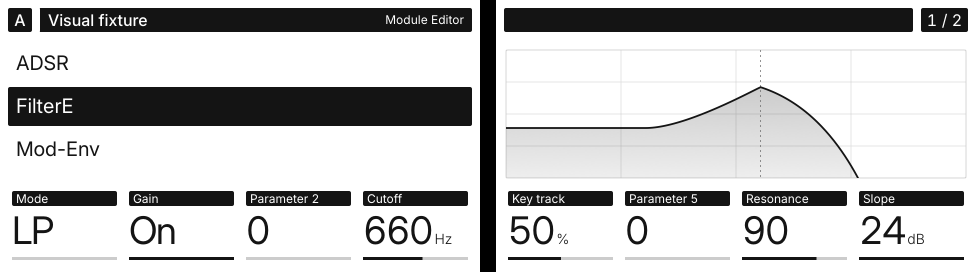

# Nord Modular Expander for Ni Controllers

**Work in progress.** The core controller and bridge functionality is in place. The screen design, layout and visual feedback will be refined in future updates.

Control Nord Modular G1 patches in the official **G1-Emu VST** from a **Maschine MK3** or **Komplete Kontrol S49 Mk2** on Apple Silicon macOS.

- Turn the patch's assigned knobs or open Module Edit to adjust individual filters, envelopes and oscillators. The displays show parameter values and diagrams for supported modules.
- Edit note, control and event sequences from the hardware and follow the live playhead.
- Browse patch files and emulator banks, switch between slots A–D, adjust supported patch output levels, and restore edited parameters to their loaded values.

G1-Emu runs the synth and audio in your DAW. Performance MIDI keeps its usual DAW routing. Use the existing G1 editor for full patch construction and cabling.

## Setup

1. Install Native Instruments' controller software and keep its background services running.
2. Install the official **G1-Emu.vst3** under `~/Library/Audio/Plug-Ins/VST3`, rescan your DAW, and load G1-Emu. The reference build is [v0.1.0-alpha.30](https://github.com/animatek/G1-Emu/releases/tag/v0.1.0-alpha.30). Select your own compatible ROM in the plugin and enable DirectLink.
3. With Rust, Python 3.9 or later, CMake 3.22 or later and the Xcode Command Line Tools installed, build from the repository root.

   ```sh
   cargo build --locked --release
   python3 scripts/build_official_adapter.py
   ```

4. Double-click **Maschine.command** or **KompleteKontrol.command**. This installs a per-user service that connects when the plugin is available. Run the other launcher to switch controllers while the VST stays open.

[Controller reference](docs/key-assignments.md) · [Architecture and development](docs/architecture.md) · [Licensing and dependencies](docs/licensing.md)

## Controller displays

The bridge keeps the Maschine MK3 and Komplete Kontrol S49 Mk2 displays in sync with G1-Emu as you turn knobs, browse patches and edit sequences. The “living” halftone blob is an experiment in interactive feedback that expands and fades as you play MIDI notes, and you can turn it off with knob 2 in Display settings.

The built-in renderer produced these dual-screen captures in the Dark theme using development fixtures.


[Still image of the Home screens](docs/screenshots/home.png)





## Patch library and troubleshooting

The launcher prints the data folder and service label. New installations use `~/Library/Application Support/Nord Modular NI Interface/`. In that folder, `keyboard-preferences.json` records the active `patch_dir`. To import a different local `.pch` library, set `source_patch_dir` to the absolute source path, remove the `patch_dir` entry and rerun the launcher. The installer copies the patches into a private library and records its new `patch_dir`. Add patches to the active folder and use **Refresh** in Browser. The source folder stays intact. The repo includes three development fixtures.

- **Bridge is waiting.** Check that the official VST is open, DirectLink is enabled and the connection is free. The service picks the first available plugin on ports `47310–47317` and keeps it until it closes. To select an instance, add its numeric port as `"direct_port"` in `keyboard-preferences.json`, preserving the library settings. Remove the key for automatic selection.
- **Another app has the panel.** Select the bridge in the NI instance menu. The shortcut and display name depend on the controller. [Native shortcuts](docs/key-assignments.md#settings-and-native-shortcuts)
- **Check the service.** Read `keyboard-status.json`, `keyboard-service.log`, `keyboard-controller.log` and `adapter-session.log` in the service data folder. For launch failures, check `keyboard-launch-error.log`. For screen lag, set `"trace_pipeline": true`, restart the bridge with its launcher, then run `python3 scripts/trace_keyboard.py` to summarize the ten-minute trace. Remove the setting when finished. The trace ends at host transfer and cannot time physical LCD scanout.

To stop the bridge for the current login session, run `launchctl bootout "gui/$(id -u)/local.nord-modular-ni-interface.keyboard"`. If your launcher prints a different label, use that label after the final slash. G1-Emu and NI services keep running. Run the launcher to start the bridge again.

## License

The original project code and bundled development patch fixtures are licensed under the [GNU General Public License, version 3 only](LICENSE). Encdr, Encdr View, and other third-party components retain their own terms and notices. See [licensing and third-party sources](docs/licensing.md) for details.
