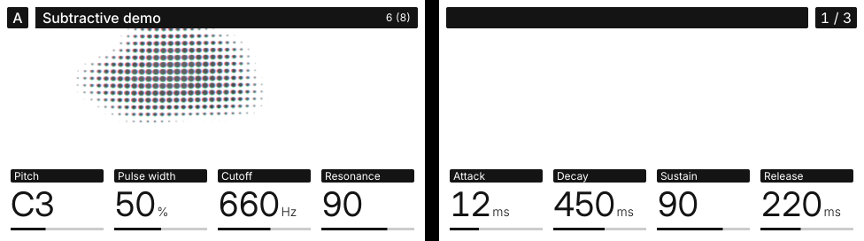
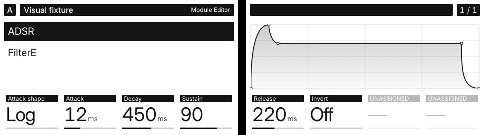
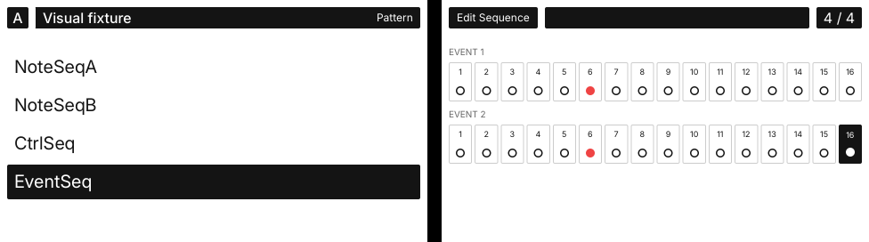

# Nord Modular NI Interface

Control a Nord Modular G1 patch from a **Maschine MK3** or **Komplete Kontrol S49 Mk2**. The hardware encoders and dual displays give you hands-on control of the patch loaded in the **official G1-Emu VST** on macOS. See parameter values as you turn a knob, shape a filter or envelope with a visual diagram, and edit sequencer steps while following the live playhead.

- **Play and tweak.** Use the patch’s assigned knobs across pages. Open the Module Editor to adjust individual modules such as oscillators, filters and envelopes, including parameters outside the assigned knob pages.
- **Edit sequences.** Select a sequencer in the loaded patch and adjust note, control or event steps from the hardware. The red playhead shows where the sequence is running.
- **Browse and switch sounds.** Browse local patch files and emulator banks, load into slots A–D, switch between slots, and adjust supported slot output levels in the mixer.
- **Restore a starting point.** Use ERASE or CLEAR to return edited parameters in the active slot to the values the bridge captured when it read the loaded patch.

G1-Emu runs the synth and audio in your DAW. Performance MIDI follows your existing DAW routing, and full patch construction and cabling use the existing G1 editor.

## Setup

Install the official **G1-Emu.vst3**, rescan in your DAW, and load **G1-Emu**. Keep the Native Instruments services running. Once installed, the bridge starts when the plugin is available and releases the controller when it closes. [Official plugin setup](docs/plugin-guide.md)

On the first setup, build the controller and adapter with Rust, Python 3, CMake and the Xcode Command Line Tools.

```sh
cargo build --locked --release
python3 scripts/build_official_adapter.py
```

Then double-click **Maschine.command** for Maschine MK3 or **KompleteKontrol.command** for the S49 Mk2. The service uses one surface at a time. Run the other launcher to switch while G1-Emu stays open. [Maschine controls](docs/key-assignments.md#maschine-mk3-with-the-official-vst) · [S49 guide](docs/komplete-keyboard.md) · [Adapter build details](integrations/g1-official/README.md)

## Controller displays

Both controllers use the same dual-screen interface. These captures come from the built-in screen preview with development fixtures.








## Controller shortcuts

**ARRANGER** on Maschine MK3 or **PATTERN** on S49 Mk2 opens the sequencer page. Display button 5 unlocks the right display for step navigation and editing. Switching it off returns the wheel to sequencer selection on the left. The live playhead uses red circles. Centre press toggles event steps.

**ERASE** on Maschine MK3 or **CLEAR** on the S49 Mk2 restores changed parameters to the current slot’s loaded values, including assigned knobs and Module Editor edits, without reloading the patch. See [key assignments](docs/key-assignments.md).

## Local files

The repository includes three project-owned patch fixtures for development checks. Supply your own compatible ROM and patch library for normal use. See [official plugin setup](docs/plugin-guide.md) for requirements.

## Licensing and dependencies

See [Licensing and third-party sources](docs/licensing.md) for component terms, source pins, and requirements for redistributing builds.
